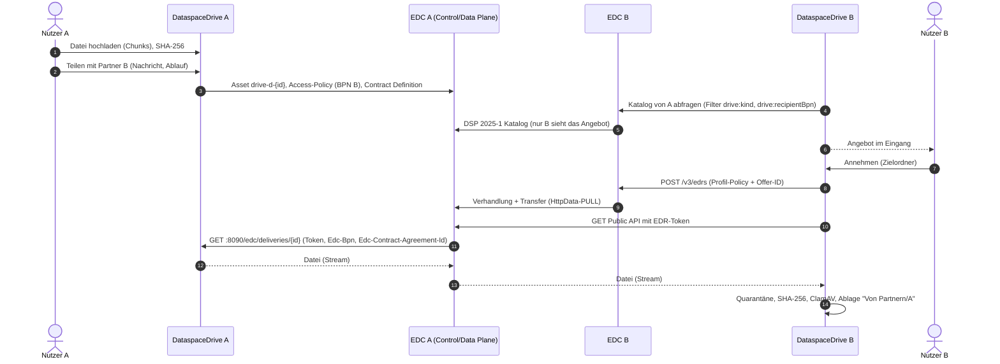

# Konzept: DataspaceDrive

Stand: 12.10.2026: Phase 1 abgenommen, Phase 2 (Teilen über den Dataspace) umgesetzt. Arbeitstitel analog zum DataspaceOperator.

## 1. Ziel

Der wind-x Dataspace läuft technisch:
- Alice, Bob und Dave betreiben Tractus-X EDC 0.12.1.
- Der DataspaceOperator stellt die Credentials aus und betreibt das BDRS.
- DSP 2025-1 funktioniert.

Was fehlt, ist eine Anwendung für normale Mitarbeitende. Heute braucht jeder Dateiaustausch jemanden, der Asset, Policy und Contract Definition anlegt, und auf der Gegenseite jemanden, der Katalog, Verhandlung und Transfer bedient. Die wind-x Use Cases brauchen genau diesen Austausch: UC4_1 (Wartungspflichtenheft, PDFs, rollenbasiertes Teilen) und UC4_2 (Begehungen, Fotos, Anhänge).

DataspaceDrive ist eine Web-Anwendung „wie Dropbox“, die jedes Unternehmen intern neben seinem EDC betreibt:
- Nutzer legen Dateien ab und geben sie gezielt an Partnerunternehmen frei.
- Jede Freigabe wird zu einem EDC-Angebot, das nur der adressierte Partner sieht und abrufen kann.
- Der Partner übernimmt die Datei nach Annahme in seine eigene DataspaceDrive.

## 2. Entscheidungen

| Thema | Entscheidung | Begründung |
|---|---|---|
| Backend | ASP.NET Core (.NET 10), modularer Monolith, **ohne XAF** | Kern sind Datei-Streaming, Chunk-Uploads, EDC-Orchestrierung und Ordnerrechte; dafür liefert XAF nichts. Die generierte Blazor-UI entfällt bei einem Angular-Frontend. Fieldservice (odata-/upload-api) und EdcAdmin folgen schon diesem Muster. Der DataspaceOperator zeigt die XAF-Kosten: Lizenzdatei im CI, EF-Core-8-Bindung, ~490-MB-Image, Deadlocks auf Blazor-Circuits. |
| Frontend | Angular 22 + DevExtreme 26.1 | Wie Fieldservice. `FileManager` mit `CustomFileSystemProvider`, `FileUploader` mit Chunks und `DataGrid` sind enthalten. Admin-Funktionen liegen als Bereich in derselben App. |
| Speicher | Dateisystem-Adapter auf verschlüsseltem PVC (`csi-cinder-high-speed-gen2-luks`); S3-Adapter später | Keine Zusatzdienste. Folge: eine Replik, Strategy `Recreate`, Hintergrunddienste im selben Prozess. |
| Empfang | Eingang mit manueller Annahme | Der Empfänger behält die Kontrolle; Prüfsumme und Virenscan laufen vor der Ablage. |
| Anmeldung | Generisches OIDC; für windx Keycloak 26 (Realm-Import wie im Fieldservice-Chart) | Kunden binden ihren eigenen IdP an. |
| Transfer | HttpData-PULL über die Tractus-X-EDR-API | Im Spike mit 1 GiB verifiziert. Uploads über die Dataplane gehen nicht, weil der Body als String gelesen wird. |
| Mandanten | Eine Instanz je Unternehmen (BPN) im Namespace neben dem EDC | Entspricht dem souveränen Teilnehmer im Dataspace. |

## 3. Ablauf



## 4. Anwendungen je Unternehmen

| Komponente | Art | Hinweise |
|---|---|---|
| `dataspace-drive` | **neu**, ein Image (API/BFF, SPA, Hintergrunddienste) | Port 8080 für UI/API über den Ingress (nur intern); Port 8090 Content-Endpunkt nur für die Dataplane (ClusterIP + NetworkPolicy) |
| PostgreSQL 16 (DB `drive`) | neu, Standard-Image | eigene Instanz mit LUKS-PVC oder extern; getrennt von der edc/ih-DB |
| ClamAV (`clamav/clamav`) | neu, Standard-Image | clamd TCP 3310, 2–3 GiB RAM, Limits für große Dateien anheben |
| PVC `dataspace-drive-data` | neu | `/data/blobs`, `/data/uploads`, `/data/quarantine` |
| Keycloak | nur windx/Demo | ein Realm je Unternehmen; Kunden nutzen ihren IdP |
| EDC, IdentityHub, Vault, DataspaceOperator, EdcAdmin | unverändert | höchstens Helm-Werte (z. B. Timeouts am Dataplane-Ingress) |

## 5. Projekte im Repo

```
backend/
  DataspaceDrive.slnx, Directory.Build.props, Directory.Packages.props (feste Versionen), global.json
  src/DataspaceDrive.Api             Host: REST-API, OIDC-BFF, SPA-Hosting, Content-Endpunkt :8090, Hintergrunddienste
  src/DataspaceDrive.Core            Domäne, Statusmaschinen, Zugriffsprüfung, Zustell-Token, Ports; frameworkfrei
  src/DataspaceDrive.Infrastructure  EF Core/Npgsql, Blob-Adapter, ClamAV, Outbox
  src/Swms.Edc.Client                EDC-Management-Client, Austauschprofil, Request-Builder, Versionsprofile
  tests/…                            xUnit; WebApplicationFactory; Golden-Tests der EDC-Requests
frontend/dataspace-drive/            Angular 22 + DevExtreme 26.1 (core/, shell/, features/)
deploy/dataspace-drive/              Helm-Chart, values-<teilnehmer>.yaml
spike/                               Spike-Skripte (Phase 0)
docs/                                Konzept, Spike-Ergebnisse
```

EdcAdmin wird nicht verändert. Wiederverwendbare Teile werden portiert: BDRS-Verzeichnis, DSP-Discovery, Download-Stream, Dockerfile, Workflows, Helm-Grundgerüst.

## 6. Austauschprofil v1 (EDC-Abbildung)

Das Austauschprofil ist der Vertrag zwischen zwei Drive-Instanzen. Beide Seiten müssen es kennen, weil der Empfänger die Contract-Policy beim Verhandeln in genau der Form des Anbieters zurückschickt (Spike S5).

### 6.1 Zustellungen

- **Zustellung:** Eine Freigabe an **ein** Partnerunternehmen ergibt ein eigenes Asset und eine eigene Contract Definition. Eine Freigabe an mehrere Partner erzeugt mehrere Zustellungen. Das hält Mitempfänger verborgen, ermöglicht Widerruf und Ablauf je Empfänger und ordnet Asset und BPN eindeutig zu.
- **IDs:** Asset `drive-d-{deliveryId}`, Contract Definition `drive-cd-{deliveryId}`, Access-Policy `drive-ap-{BPN}` (je Partner wiederverwendet), Contract-Policy `drive-cp-{profil}-v{n}` (unveränderlich, neue Versionen statt Änderungen).
- **Namensraum** der eigenen Properties: `https://ns.swms-cloud.com/drive/v1/`.
- **Öffentliche Asset-Properties:** `name`, `dct:title`, `drive:kind=delivery`, `drive:schemaVersion`, `drive:recipientBpn`, `drive:senderBpn`, `drive:senderOrganization`, `drive:expiresAt`, `drive:itemCount`, `drive:totalSize` und `drive:manifest` (JSON mit Name, Größe, SHA-256 und MIME je Datei, ASCII-escaped).
- **Private Properties:** `drive:deliveryId`, `drive:instanceId`.
- **dataAddress:**
  - `type=HttpData`
  - `baseUrl=http://<release>-edc.<ns>.svc.cluster.local:8090/edc/deliveries/{deliveryId}`
  - `proxyPath=true`, `proxyQueryParams=true` (für `/items/{id}` und `offset`/`length`)
  - `authKey=X-Drive-Delivery-Token`, `authCode=v{n}.base64url(HMAC-SHA256(Schlüssel n, deliveryId))`
- HttpData statt ProxyHttpData, weil nur HttpData unter 0.12.1 die Header `Edc-Bpn` und `Edc-Contract-Agreement-Id` mitschickt.

### 6.2 Policies

- **Access-Policy:** Action `cx-policy:access`, `Membership eq active` UND `BusinessPartnerNumber isAnyOf [BPN]`, mit vollen IRIs und dem Kontext `https://w3id.org/dspace/2025/1/odrl-profile.jsonld`. Der Anbieter prüft sie beim Katalog und erneut bei der Verhandlung (S2).
- **Contract-Policy:** Profil „membership“: Action `cx-policy:access`, `Membership eq active`. Das Profil „cx“ (FrameworkAgreement + UsagePurpose `windx.drive.fileExchange:1`) folgt, sobald die DataExchangeGovernance-Credentials aller Teilnehmer die vom Connector erwartete Version tragen (Spike S1).
- **Contract Definition:** `assetsSelector` mit `edc:id = drive-d-{deliveryId}`. Ein leerer Selektor ist im Client ausgeschlossen.

### 6.3 Verhandlung beim Empfänger

1. Discovery: `POST /v4alpha/connectordiscovery/dspversionparams` (0.13: `/v3/...`) liefert Protokoll, Adresse und DID.
2. Katalog mit `filterExpression` auf `drive:kind` und `drive:recipientBpn`, seitenweise bis zur leeren Seite.
3. `POST /v3/edrs` mit `@context [odrl-profile, {@vocab: edc, odrl}]`. Die Policy besteht aus `@id` (Offer-ID aus dem Katalog), `@type odrl:Offer`, `odrl:assigner {@id: DID des Anbieters}`, `odrl:target {@id: Asset}` und den Berechtigungen aus dem Profil.
4. Warten auf FINALIZED, danach EDR über `POST /v3/edrs/request` (Filter `contractNegotiationId`) und `GET /v3/edrs/{tp}/dataaddress?auto_refresh=true`.
5. Download per GET mit `Authorization: <token>` (ohne „Bearer“), segmentiert über `offset`/`length`, in die Quarantäne. Danach SHA-256 und Größe gegen das Manifest prüfen, ClamAV, Ablage, Transfer terminieren.

### 6.4 Content-Endpunkt

Der Content-Endpunkt (`GET :8090/edc/deliveries/{id}[/items/{itemId}]`) prüft in dieser Reihenfolge:
1. Anfrage kam über den Content-Port (`Connection.LocalPort`); die NetworkPolicy lässt nur Dataplane-Pods zu.
2. Das Zustell-Token ist gültig (HMAC, Vergleich mit konstanter Laufzeit, versionierte Schlüssel).
3. Die Zustellung ist `Active`, nicht abgelaufen, und der Partner ist nicht gesperrt.
4. `Edc-Bpn` entspricht der Empfänger-BPN.
5. `Edc-Contract-Agreement-Id` ist im eigenen EDC bekannt (`GET /v3/contractagreements/{id}`), nicht zurückgezogen, und das Asset passt.

Danach streamt der Endpunkt sofort, weil die Dataplane nach 30 s ohne Daten abbricht. Jede Ablehnung und jeder Abruf landen im Audit.

### 6.5 Widerruf und Ablauf

1. Status sofort auf `Revoking`; der Content-Endpunkt verweigert ab dann.
2. Contract Definition löschen.
3. Agreements des Assets über `POST /v3/contractagreements/retirements` zurückziehen (`@type AgreementsRetirementEntry`, `agreementId`, `tx:reason`).
4. Das Asset bleibt als Grabstein stehen, weil es mit Agreements nicht löschbar ist (409).

Ein laufender Download wird durch das Retirement nicht abgebrochen (S7). Bei segmentiertem Abruf wirkt der Widerruf ab dem nächsten Segment.

### 6.6 Robustheit

- EDC-Anlagen laufen über eine Outbox in derselben Transaktion wie die Fachänderung, mit deterministischen IDs. Eine Antwort 409 wird als „bereits angelegt“ behandelt und verglichen.
- Ein Reconciliation-Job gleicht `drive-*`-Objekte mit der Datenbank ab und meldet **offene Contract Definitions** (leerer oder zu breiter Selektor; im Spike beobachtet).
- `Swms.Edc.Client` kapselt alle Pfade und Formen. Das Versionsprofil `tractusx-0.12`/`tractusx-0.13` steuert die Unterschiede, etwa Discovery-Pfad und Identitäts-Header für alle Adresstypen ab 0.13.

## 7. Domänenmodell

| Entität | Kern |
|---|---|
| User | OIDC-Subject, E-Mail, Name; beim ersten Login angelegt |
| Space / Folder | Bereich (persönlich, Team, Partner-Eingang); Ordnerbaum |
| FileEntry / FileVersion | unveränderliche Versionen mit Blob-Key, Größe, SHA-256, MIME, Scan-Status |
| UploadSession | Chunk-Upload mit Ablauf |
| AclEntry | Rechte je Bereich (später je Ordner): Lesen, Schreiben, Verwalten |
| Partner | BPN, DID, Name, DSP-Adresse, Quelle (BDRS/manuell), Freigabe- und Empfangsschalter, Sperre |
| Share / ShareItem | Freigabe mit Titel, Nachricht, Ablauf; Datei-Versionen als Schnappschuss |
| Delivery | Zustellung je Empfänger mit EDC-IDs, Token-Version, Status, Abrufzähler |
| KnownAgreement | Cache der Agreements für den Content-Endpunkt |
| IncomingOffer / IncomingItem | Eingang: Anbieter, Asset, Manifest, Verhandlung, Transfer, Prüfergebnis |
| OutboxMessage, AuditEvent | ausstehende EDC-Operationen; Audit nur anfügen, mit Hash-Kette |

**Statusmaschinen** (umgesetzt in `DataspaceDrive.Core`):
- **Zustellung:** `Requested → Provisioning → Active → Revoking → Revoked`; `Active → Expiring → Expired`; `Provisioning → ProvisioningFailed → Provisioning | Revoking`; `Requested → Rejected`.
- **Eingang:** `New → Accepted → Negotiating → AwaitingTransfer → Downloading → Verifying → Scanning → Completed`. Daneben `Declined`, `Withdrawn` (kehrt nach `New` zurück, wenn das Angebot wieder auftaucht), `Expired`, `Failed` (Retry nach `Accepted`) und `Quarantined` (endgültig).

## 8. REST-API (Auszug)

| Bereich | Endpunkte |
|---|---|
| Session | `GET /api/auth/login`, `POST /api/auth/logout`, `GET /api/me`, `GET /api/config` |
| Dateien | `GET /api/folders/{id}/children`, `POST /api/folders`, `PATCH`/`DELETE /api/files/{id}`, `GET /api/files/{id}/content` |
| Upload | `POST /api/uploads`, `PUT /api/uploads/{id}/chunks/{index}`, `POST /api/uploads/{id}/complete` |
| Freigaben | `POST /api/shares`, `GET /api/shares[/{id}]`, `POST /api/shares/{id}/revoke`, `POST /api/shares/{id}/recipients/{bpn}/revoke` |
| Eingang | `GET /api/inbox`, `POST /api/inbox/{id}/accept`, `POST /api/inbox/{id}/decline`, `POST /api/inbox/refresh` |
| Verwaltung | Partner, Policy-Profile, Audit (Export, Prüfung der Hash-Kette), EDC-Status, Reconciliation, Outbox, Quarantäne |

## 9. Sicherheit

- **Anmeldung:** OIDC Code Flow mit PKCE im BFF; Tokens erreichen nie den Browser. HttpOnly-Cookie, Antiforgery-Token, Data-Protection-Keys in Postgres.
- **Rollen:**
  - `drive-user`
  - `drive-external-share`: darf an andere Unternehmen freigeben
  - `drive-inbox`: Eingang annehmen und ablehnen
  - `drive-admin`
  - optional `drive-approver`: Vier-Augen-Freigabe
- **Geheimnisse:**
  - Der EDC-Management-Key liegt nur serverseitig; die Drive beschränkt sich per Code auf `drive-*`-Objekte.
  - Der Schlüsselring der Zustell-Tokens kommt aus einem K8s-Secret. Ein Vault ist nicht nötig, das vermeidet die Abhängigkeit vom flüchtigen Vault.
- **Netz:** Port 8090 nur aus Dataplane-Pods, Port 8080 nur aus dem Ingress-Controller (beides NetworkPolicy; Calico/Canal setzt sie im Cluster durch, Spike S8).
- **Verschlüsselung:** LUKS-PVCs für Blobs und DB; TLS an Ingress, DSP und Public API.
- **Integrität und Schadcode:** SHA-256 beim Upload, im Manifest und beim Empfang. ClamAV bei Upload und Empfang; nicht prüfbare Dateien bleiben in der Quarantäne.
- **Datenschutz:** Titel, Nachricht, Dateinamen und Absenderorganisation sieht der Empfänger im Katalog. Die UI weist darauf hin; Personen werden standardmäßig nicht genannt.

## 10. Phasen

| Phase | Inhalt | Abnahme |
|---|---|---|
| 0 Konzept & Spike | Konzept, Spike, Repo-Skelett | **erledigt**, siehe `docs/spike-ergebnisse.md` |
| 1 Drive intern | OIDC, Bereiche/Ordner, Chunk-Upload, Download, Versionen, Papierkorb, ClamAV beim Upload, Helm/CI, Deployment Alice und Bob | **abgenommen** 12.10.2026 (`e2e/phase1_acceptance.py`): mehrere Nutzer parallel, 2-GB-Datei, Neustart ohne Datenverlust |
| 2 Teilen (MVP) | Partner, Freigabe-Dialog, Outbox/EDC-Anlage, Content-Endpunkt, Abrufprotokoll, Widerruf, Ablauf; Eingang mit Polling, Annahme, segmentiertem Download, Prüfung, Ablage; Audit; Reconciliation | **umgesetzt**; E2E-Testplan mit `e2e/phase2_acceptance.py` (Abschnitt 12) |
| 3 Ausbau | Benachrichtigung über ein Eingangs-Asset, E-Mail, Ordner-Freigaben, neue Versionen geteilter Dateien, Vier-Augen-Freigabe, Policy-Profile, Vorschau, optional Auto-Annahme | je Feature |
| 4 Härtung | S3-Adapter und mehrere Repliken, Backups, OpenTelemetry, Last- und Pentest, Profil 0.13, Kunden-Doku | Restore-Test, Update ohne Ausfall |

## 11. Risiken

| Risiko | Gegenmaßnahme |
|---|---|
| Offene Contract Definitions im Connector (leerer Selektor, im Spike beobachtet) heben den Katalogschutz auf | Prüfkette im Content-Endpunkt (BPN, Agreement); Reconciliation meldet offene Definitionen |
| Policy-Gleichheit beim Verhandeln | Profil-Form statt kompakter Katalog-Offers (S5), Golden-Tests |
| Version des DataExchangeGovernance-Credentials | Profil „membership“, bis alle Teilnehmer passende Credentials haben |
| Dataplane-Warteschlange bei vielen parallelen Abrufen | Begrenzung beim Empfänger, segmentierter Abruf, weitere Dataplane-Repliken |
| Laufender Download nach Widerruf | Segmente; Widerruf wirkt ab dem nächsten Segment |
| 30 s Leerlauf-Timeout der Dataplane | Content-Endpunkt streamt direkt vom Blob |
| Upgrade auf tractusx-edc 0.13 | Versionsprofil, Golden-Tests, E2E-Wiederholung |
| Eine Replik wegen RWO-PVC | Wartungsfenster; S3 in Phase 4 |

## 12. E2E-Testplan (Phase 2)

| ID | Szenario | Erwartung |
|---|---|---|
| T1 | Freigabe an einen Partner | Angebot im Eingang; Annahme; identischer SHA-256; Abruf beim Anbieter protokolliert |
| T2 | Freigabe an zwei Partner | Jeder sieht nur seine Zustellung; Widerruf für einen lässt den anderen unberührt |
| T3 | 1 GB und 5 GB, 4 parallele Abrufe | ohne Timeout, Durchsatz dokumentiert |
| T4 | Ablauf | Angebot verschwindet; Content-Endpunkt antwortet 410 |
| N1 | Dritter Teilnehmer fragt den Katalog ab | Zustellung nicht sichtbar |
| N2 | Dritter verhandelt mit fremdem Offer | abgelehnt |
| N3 | Abruf mit gültigem Token, aber falscher `Edc-Bpn` oder fremdem Agreement | 403 und Audit |
| N4 | Port 8090 aus fremdem Pod, `/edc/*` über den Ingress | blockiert bzw. 404 |
| N5 | Nach Widerruf | altes Token 403, Neuverhandlung scheitert, Agreement zurückgezogen |
| N6 | EICAR beim Upload und beim Empfang | blockiert bzw. Quarantäne |
| N7 | Nutzer ohne `drive-external-share` | kein Teilen-Knopf, API 403 |

## 13. Abweichungen gegenüber dem freigegebenen Plan

| Plan | Jetzt | Grund |
|---|---|---|
| Ein Asset je Freigabe | ein Asset je Zustellung (Freigabe × Empfänger) | Mitempfänger verborgen, Widerruf je Empfänger, eindeutige BPN-Zuordnung |
| Auth-Header per Vault (`secretName`) | HMAC-Token je Zustellung als `authCode` | keine Abhängigkeit vom flüchtigen Vault; Token gilt nur für eine Zustellung |
| Content-Port 8081 | 8090 | Verwechslung mit der Dataplane (8081) vermeiden |
| Zugriffsprüfung über Token und BPN | zusätzlich Agreement-Prüfung im eigenen EDC | Spike: eine Contract Definition mit leerem Selektor hebt den Katalogschutz auf |
| Offer aus dem Katalog weiterreichen | Policy aus dem Austauschprofil, nur Offer-ID aus dem Katalog | Spike S5: kompakte Offers scheitern an der Policy-Gleichheit |
| Contract-Policy CX (FrameworkAgreement + UsagePurpose) | Profil „membership“ als Standard | Spike S1 |
| Download in einem Stück | segmentiert über `offset`/`length` | Spike S6/S7: fortsetzbar, Widerruf wirkt schneller |
| BDRS-Import der Partner (offen) | Partner pflegt die Verwaltung mit BPN und DSP-Adresse; DID und Protokoll löst der eigene Connector auf (`dspversionparams`) | Der Connector fragt das BDRS selbst; die Drive braucht kein STS-Secret. Die DID-Dokumente im windx-Dataspace tragen keinen DataService-Eintrag, daher bleibt die DSP-Adresse eine Angabe der Verwaltung. |
| Dateien bis 5 GB | mit Virenscan bis 2047 MiB | ClamAV prüft höchstens 2 GiB − 1 Byte; ungeprüfte Dateien bleiben gesperrt |
| 2 Abrufe je Anbieter, 4 insgesamt | der Empfänger übernimmt Angebote nacheinander | einfach und schont die Dataplane des Anbieters; Parallelität folgt bei Bedarf |
| Asset bleibt als Grabstein | ohne Agreements wird das Asset gelöscht, mit Agreements bleibt es ohne Contract Definition stehen | hält den Connector sauber, wo es geht (Spike S9) |
| Entität KnownAgreement | Agreements 30 s im Speicher zwischengespeichert | ein Widerruf ändert zuerst den Zustand der Zustellung und wirkt dadurch sofort |
| Audit mit Hash-Kette | Audit nur anfügen, ohne Hash-Kette | folgt mit der Härtung (Phase 4) |
| Freigabe aus jedem Bereich | aus Team-Bereichen nur, wenn die Verwaltung externes Teilen erlaubt; aus „Meine Dateien“ immer | Team-Inhalte gehören dem Team, nicht dem Einzelnen |

## 14. Offene Entscheidungen

- Zeitpunkt für das CX-Usage-Profil (setzt passende DataExchangeGovernance-Credentials bei allen Teilnehmern voraus).
- Aufbewahrungsfristen für Audit und empfangene Dateien.
- Umgang mit Dateien über der Grenze des Virenscans (heute abgelehnt; denkbar: Freigabe ungeprüfter Dateien durch die Verwaltung).

Entschieden in Phase 2:
- Namensraum `https://ns.swms-cloud.com/drive/v1/`.
- Ablauf standardmäßig 30 Tage, höchstens 90; Dateigröße mit Virenscan bis 2047 MiB.
- Kein BDRS-Import in der Drive: die DID löst der Connector auf (siehe Abschnitt 13).
